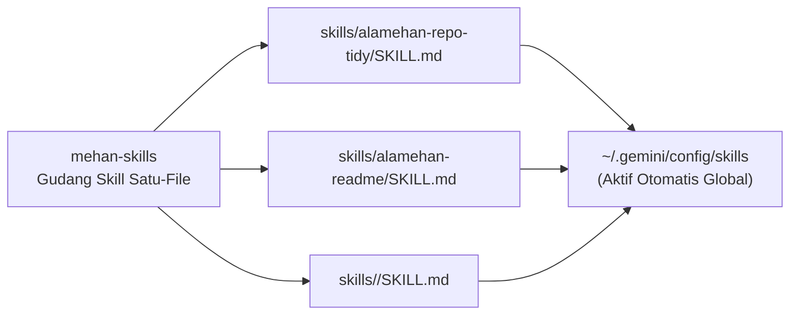

<div align="center">
  <picture>
    <source media="(prefers-color-scheme: dark)" srcset="./assets/readme-header-dark.svg" />
    <source media="(prefers-color-scheme: light)" srcset="./assets/readme-header-light.svg" />
    
  </picture>

  <p>
    <a href="./README.md">← English</a> · <strong>Bahasa Indonesia</strong>
    &nbsp;&nbsp;·&nbsp;&nbsp;
    <a href="./skills"><strong>✨ Lihat Daftar Skill</strong></a> ·
    <a href="https://alamehan.github.io">Portfolio</a> ·
    <a href="./LICENSE">Lisensi MIT</a>
  </p>
</div>

> ⚡ Kumpulan playbook satu-file yang melatih AI coding agent merapikan repo kusut & menulis dokumentasi 2 bahasa yang ramah — crafted by @alamehan
>
> `ai-agents` `agent-skills` `prompt-engineering` `claude-code` `cursor` `antigravity` `developer-tools` `documentation`

---

## Kenapa Mehan Skills Dibuat

Setiap kali memulai proyek baru atau membuka sesi obrolan AI baru, mengulang standar kerja yang sama — bagaimana merapikan isi folder proyek tanpa merusak fitur yang sudah jalan, atau bagaimana menyusun dokumentasi yang enak dibaca semua orang — memakan banyak waktu dan sering melenceng kalau aturannya hanya tersimpan di riwayat chat lama.

**Mehan Skills** merangkum alur kerja Product Design dan Product Engineering dari **[M. Raihan Rafiiful Allaam (`@alamehan`)](https://alamehan.github.io)** ke dalam **buku panduan satu file yang praktis**. Setiap skill berdiri utuh di dalam satu file `.md` yang bisa langsung terbaca otomatis di seluruh ruang kerjamu, atau cukup dilampirkan kapan saja di chat AI pilihanmu.

---

## Langsung Lihat & Coba Sekarang

| Apa yang ingin kamu lakukan | Buka bagian ini |
|---|---|
| **Merapikan struktur folder proyek yang berantakan tanpa bikin error** | Buka **[`alamehan-repo-tidy`](./skills/alamehan-repo-tidy/SKILL.md)** |
| **Membuat halaman depan GitHub 2 bahasa yang ramah & beranimasi 2.5D** | Buka **[`alamehan-readme`](./skills/alamehan-readme/SKILL.md)** |
| **Melihat karya produk, design system & studi kasus `@alamehan` lainnya** | Kunjungi **[alamehan.github.io](https://alamehan.github.io)** |

---

## Keunggulan Utama

- **Cukup Satu File Utuh:** Setiap skill tersimpan lengkap di dalam satu file `SKILL.md` (berisi panduan, cetakan visual, hingga daftar pengecekan akhir) tanpa tercecer ke banyak file tambahan.
- **Perapihan Repo Tanpa Waswas (`alamehan-repo-tidy`):** Memandu AI mengenali jalur penting lebih dulu, merapikan skrip dan folder yang kusut, memperbarui seluruh tautan kode yang ikut pindah, lalu memastikan aplikasi tetap berjalan mulus.
- **Dokumentasi Ramah Semua Kalangan (`alamehan-readme`):** Menyusun cerita pembuka yang jernih dengan tipografi desainer asli (`Bricolage Grotesque` + `Figtree` + `Geist Mono`), deskripsi *GitHub About* + *Topics* siap salin, serta panduan teknis developer di dalam laci lipat.
- **Fleksibel di Semua Alat AI:** Bisa dipasang otomatis secara global di Antigravity, maupun dilampirkan manual sebagai 1 file `.md` di Claude, ChatGPT, Cursor, atau Codex.

---

## Detail Teknis & Panduan Developer

<details>
<summary><strong>🛠️ Cara Pasang Cepat — Aktif Otomatis Global &amp; Lampiran Manual</strong></summary>

### Cara 1 · Aktif Otomatis di Semua Proyek Lokal (Antigravity / Gemini)
Kloning repositori ini satu kali, lalu hubungkan folder `./skills` ke `~/.gemini/config/skills` agar seluruh skill otomatis aktif di setiap proyekmu:

```powershell
# Windows PowerShell (tanpa perlu akses Administrator)
git clone https://github.com/alamehan/mehan-skills.git
cd mehan-skills
New-Item -ItemType Junction -Path "$HOME\.gemini\config\skills" -Target "$PWD\skills"
```

```bash
# macOS / Linux
git clone https://github.com/alamehan/mehan-skills.git
cd mehan-skills
ln -s "$PWD/skills" "$HOME/.gemini/config/skills"
```

### Cara 2 · Lampirkan Manual 1 File (Claude Web, ChatGPT, Cursor, Codex)
Lampirkan langsung 1 file `SKILL.md` dari folder [`skills/`](./skills) bersama repositori targetmu, lalu minta AI menjalankan panduannya.

</details>

<details>
<summary><strong>🏗️ Katalog Skill, Peta Arsitektur &amp; Struktur Folder</strong></summary>



| Jalur | Peran |
|---|---|
| [`skills/alamehan-repo-tidy/SKILL.md`](./skills/alamehan-repo-tidy/SKILL.md) | Panduan merapikan struktur repositori secara menyeluruh dengan pelacakan referensi dan pembuktian build/tes. |
| [`skills/alamehan-readme/SKILL.md`](./skills/alamehan-readme/SKILL.md) | Cetakan banner SVG 2.5D `Porcelain SaaS` berfont desainer asli, kalimat *GitHub About*, dan standar kesetaraan 2 bahasa (`EN`/`ID`). |
| [`assets/`](./assets) | Banner panggung SVG 2.5D `@alamehan` bertema `Porcelain SaaS` versi Gelap dan Terang. |
| [`AGENTS.md`](./AGENTS.md) | Aturan baku penambahan skill baru (`1 Skill = 1 SKILL.md`, path universal, dan sinkronisasi katalog 2 bahasa). |

</details>

<details>
<summary><strong>🧭 Aturan Penulisan Skill &amp; Batasan Desain</strong></summary>

- **Murni 1 File per Skill:** Seluruh cetakan dan daftar periksa disertakan langsung di dalam `skills/<slug>/SKILL.md` agar tidak pernah rusak saat dibagikan atau dilampirkan ke chat web.
- **Bebas Path Spesifik Perangkat:** Semua contoh perintah memakai `$PWD` dan `$HOME` agar berjalan seragam di Windows, macOS, dan Linux. Baca [`AGENTS.md`](./AGENTS.md) saat ingin menambah skill baru.

</details>

---

Dirancang dan dibangun sepenuh hati oleh **[M. Raihan Rafiiful Allaam (`@alamehan`)](https://alamehan.github.io)** — *Product Designer & Product Engineer*. Dirilis di bawah [Lisensi MIT](./LICENSE).
