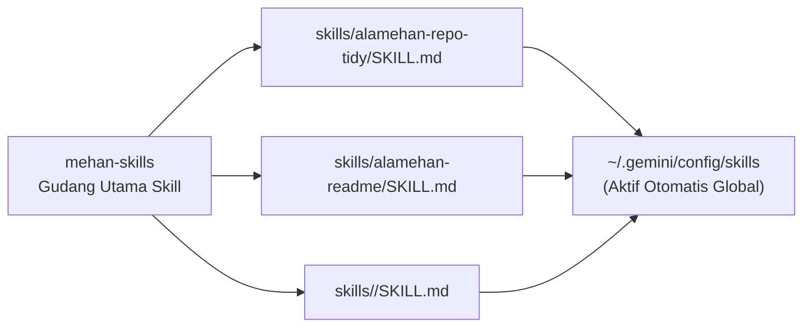

<div align="center">
  <picture>
    <source media="(prefers-color-scheme: dark)" srcset="./assets/readme-header-dark.svg" />
    <source media="(prefers-color-scheme: light)" srcset="./assets/readme-header-light.svg" />
    
  </picture>

  <p>
    <a href="./README.md">← English</a> · <strong>Bahasa Indonesia</strong>
    &nbsp;|&nbsp;
    <a href="./skills">Daftar Skill</a> ·
    <a href="./AGENTS.md">Aturan Penulisan</a> ·
    <a href="https://alamehan.github.io">alamehan.github.io</a> ·
    <a href="./LICENSE">Lisensi MIT</a>
  </p>
</div>

> [!TIP]
> **`mehan-skills`** adalah repositori khusus kumpulan *skill* AI agent portable karya **[M. Raihan Rafiiful Allaam (`@alamehan`)](https://alamehan.github.io)**. Setiap alur kerja ditulis utuh dalam **1 file `SKILL.md` mandiri** — otomatis terbaca lintas workspace di Antigravity, sekaligus siap dilampirkan langsung ke Claude, ChatGPT, Cursor, atau Codex.

| Tujuanmu | Mulai dari Sini |
|---|---|
| **Merapikan repo kusut secara menyeluruh tanpa merusak build** | Buka **[`skills/alamehan-repo-tidy/SKILL.md`](./skills/alamehan-repo-tidy/SKILL.md)** |
| **Membuat `README` GitHub 2 bahasa beridentitas `@alamehan`** | Buka **[`skills/alamehan-readme/SKILL.md`](./skills/alamehan-readme/SKILL.md)** |
| **Menghubungkan seluruh skill secara global di perangkatmu** | Lompat ke **[Mulai dalam 30 Detik](#mulai-dalam-30-detik)** |
| **Menambah atau merawat skill baru di repositori ini** | Baca **[`AGENTS.md`](./AGENTS.md)** |

---

## Kenapa `mehan-skills` Dibuat

Mengulang instruksi standar rekayasa yang kompleks di banyak repositori — seperti cara merapikan struktur folder kusut dengan aman, atau cara menyusun dokumentasi GitHub dua bahasa berbanner SVG adaptif — memakan waktu dan mudah melenceng jika hanya mengandalkan ingatan obrolan chat.

**`mehan-skills`** membungkus standar kerja dan desain khas `@alamehan` menjadi **buku panduan `SKILL.md` satu file tanpa dependensi** yang terkelola rapi di satu tempat dan siap dijalankan di lingkungan AI coding mana pun.

---

## Daftar Skill Saat Ini

| Skill | File | Fungsi Utama |
|---|---|---|
| **`alamehan-repo-tidy`** | [`skills/alamehan-repo-tidy/SKILL.md`](./skills/alamehan-repo-tidy/SKILL.md) | Memetakan jalur krusial framework, CI, dan ekspor lebih dulu, mengurai skrip silang antar-paket, menata pohon folder `src/` & `tests/` secara simetris, memperbarui 100% referensi yang terdampak, dan membuktikan semua build & tes tetap hijau. |
| **`alamehan-readme`** | [`skills/alamehan-readme/SKILL.md`](./skills/alamehan-readme/SKILL.md) | Menghasilkan banner SVG ASCII `@alamehan · Console` otomatis Gelap/Terang (`assets/readme-header-dark.svg` & `assets/readme-header-light.svg`) beserta dokumentasi setara `README.md` (Inggris) dan `README.id.md` (Indonesia natural) untuk jenis repo apa pun. |

---

## Mulai dalam 30 Detik

### 1. Aktif Otomatis di Semua Proyek (Antigravity / Gemini)
Kloning repositori ini di mana saja pada perangkatmu, lalu hubungkan `./skills` satu kali ke `~/.gemini/config/skills` agar setiap skill otomatis aktif di seluruh workspace lokalmu:

```powershell
# Windows (PowerShell — jalankan di dalam folder mehan-skills, tanpa perlu akses Admin)
git clone https://github.com/alamehan/mehan-skills.git
cd mehan-skills
New-Item -ItemType Junction -Path "$HOME\.gemini\config\skills" -Target "$PWD\skills"
```

```bash
# macOS / Linux
git clone https://github.com/alamehan/mehan-skills.git
cd mehan-skills
ln -s "$PWD/skills" "$HOME/.gemini/config/skills"
```

### 2. Lampirkan Manual 1 File (Claude Web, ChatGPT, Cursor, Codex)
Unduh atau lampirkan langsung 1 file `SKILL.md` dari folder [`skills/`](./skills) bersama repo targetmu, lalu minta AI menjalankannya.

---

## Peta Arsitektur & Struktur Folder



| Jalur | Peran |
|---|---|
| [`skills/alamehan-repo-tidy/`](./skills/alamehan-repo-tidy) | Skill perapihan struktur repositori anti-rusak dengan pelacakan referensi menyeluruh. |
| [`skills/alamehan-readme/`](./skills/alamehan-readme) | Skill standar header SVG `@alamehan · Console` & dokumentasi GitHub 2 bahasa (`EN`/`ID`). |
| [`assets/`](./assets) | Banner SVG ASCII `@alamehan · Console` versi Gelap & Terang untuk repositori ini. |
| [`AGENTS.md`](./AGENTS.md) | Aturan baku penulisan skill (`1 Skill = 1 SKILL.md`, kebersihan path publik, dan sinkronisasi 2 bahasa). |

---

<details>
<summary><strong>Ruang Lingkup &amp; Batasan Desain</strong></summary>

- **Murni 1 File per Skill:** Setiap skill di `skills/<slug>/SKILL.md` menyertakan langsung cetakan dan daftar periksanya di dalam satu file yang sama tanpa file pecahan luar, sehingga tetap 100% praktis baik untuk auto-discovery lokal maupun lampiran manual di chat web.
- **Bebas Path Spesifik Komputer:** Seluruh perintah menggunakan variabel standar `$PWD` dan `$HOME` agar langsung jalan di Windows, macOS, maupun Linux.

</details>

---

## Pembuat & Lisensi

Dirancang dan dibangun sepenuh hati oleh **[M. Raihan Rafiiful Allaam (`@alamehan`)](https://alamehan.github.io)** — *Product Designer & Product Engineer*.

Lisensi MIT — lihat [LICENSE](./LICENSE).
