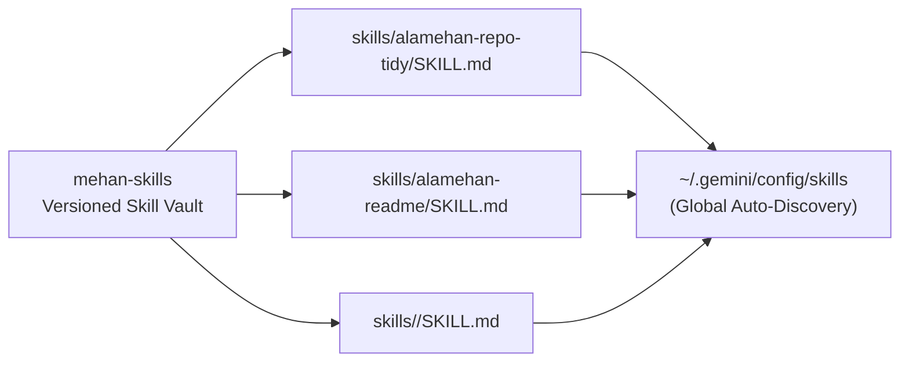

<div align="center">
  <picture>
    <source media="(prefers-color-scheme: dark)" srcset="./assets/readme-header-dark.svg" />
    <source media="(prefers-color-scheme: light)" srcset="./assets/readme-header-light.svg" />
    
  </picture>

  <p>
    <strong>English</strong> · <a href="./README.id.md">Bahasa Indonesia →</a>
    &nbsp;|&nbsp;
    <a href="./skills">Browse Skills</a> ·
    <a href="./AGENTS.md">Authoring Rules</a> ·
    <a href="https://alamehan.github.io">alamehan.github.io</a> ·
    <a href="./LICENSE">MIT License</a>
  </p>
</div>

> [!TIP]
> **`mehan-skills`** is the curated collection of portable, single-file AI agent skills authored by **[M. Raihan Rafiiful Allaam (`@alamehan`)](https://alamehan.github.io)**. Every workflow lives inside **one self-contained `SKILL.md` file** — auto-discovered globally across workspaces in Antigravity, or ready to attach directly in Claude, ChatGPT, Cursor, or Codex.

| Your Goal | Start Here |
|---|---|
| **Untangle and reorganize a messy repository without breaking builds** | Open **[`skills/alamehan-repo-tidy/SKILL.md`](./skills/alamehan-repo-tidy/SKILL.md)** |
| **Generate a signature bilingual `@alamehan` GitHub README** | Open **[`skills/alamehan-readme/SKILL.md`](./skills/alamehan-readme/SKILL.md)** |
| **Mount all skills globally on your machine in one command** | Jump to **[Start in 30 Seconds](#start-in-30-seconds)** |
| **Add or maintain a new portable skill in this repository** | Read **[`AGENTS.md`](./AGENTS.md)** |

---

## Why `mehan-skills` Exists

Repeating complex engineering standards across repositories — how to untangle messy directory trees safely, or how to write consistent bilingual GitHub documentation with adaptive SVG headers — wastes hours and drifts whenever instructions live only in chat history.

**`mehan-skills`** packages repeatable `@alamehan` engineering and design workflows into **zero-dependency, single-file `SKILL.md` playbooks** that stay version-controlled in one place and work across every AI coding environment.

---

## Included Skills

| Skill | File | What It Does |
|---|---|---|
| **`alamehan-repo-tidy`** | [`skills/alamehan-repo-tidy/SKILL.md`](./skills/alamehan-repo-tidy/SKILL.md) | Maps locked framework, CI, and export contracts first, untangles cross-package build spaghetti, groups source & test trees symmetrically, traces 100% of affected references, and enforces green-before / green-after build & test parity. |
| **`alamehan-readme`** | [`skills/alamehan-readme/SKILL.md`](./skills/alamehan-readme/SKILL.md) | Generates adaptive Dark/Light `@alamehan · Console` ASCII-monogram SVG headers (`assets/readme-header-dark.svg` & `assets/readme-header-light.svg`) plus 1:1 bilingual `README.md` (English) and `README.id.md` (natural Indonesian) for any repository shape. |

---

## Start in 30 Seconds

### 1. Automatic Global Discovery (Antigravity / Gemini)
Clone this repository anywhere on your machine and link `./skills` once to `~/.gemini/config/skills` so every skill is active across all local workspaces automatically:

```powershell
# Windows (PowerShell — run inside the cloned mehan-skills folder, no Admin needed)
git clone https://github.com/alamehan/mehan-skills.git
cd mehan-skills
New-Item -ItemType Junction -Path "$HOME\.gemini\config\skills" -Target "$PWD\skills"
```

```bash
# macOS / Linux
git clone https://github.com/alamehan/mehan-skills.git
cd mehan-skills
ln -s "$PWD/skills" "$HOME/.gemini/config/skills"
```

### 2. Direct Single-File Attachment (Claude Web, ChatGPT, Cursor, Codex)
Download or attach any single `SKILL.md` from [`skills/`](./skills) alongside your target repository and ask the agent to execute it.

---

## Architecture & Repository Map



| Path | Role |
|---|---|
| [`skills/alamehan-repo-tidy/`](./skills/alamehan-repo-tidy) | Universal non-destructive repository reorganization & reference-tracing skill. |
| [`skills/alamehan-readme/`](./skills/alamehan-readme) | Signature `@alamehan · Console` SVG header & bilingual (`EN`/`ID`) GitHub README standard. |
| [`assets/`](./assets) | Adaptive Dark & Light `@alamehan · Console` ASCII SVG banners for this repository. |
| [`AGENTS.md`](./AGENTS.md) | Authoring invariants (`1 Skill = 1 SKILL.md`, clean public paths, and bilingual catalog sync). |

---

<details>
<summary><strong>Scope &amp; Design Boundaries</strong></summary>

- **Strictly Single-File Skills:** Every skill in `skills/<slug>/SKILL.md` embeds its own templates and verification steps inline rather than splitting across external helper files, ensuring 100% drag-and-drop portability in web-based AI chats as well as local CLI/IDE agents.
- **Zero Machine-Specific Assumptions:** All instructions and snippets use portable `$PWD` / `$HOME` paths so cloning works cleanly across Windows, macOS, and Linux.

</details>

---

## Author & License

Crafted with Product Design & Engineering care by **[M. Raihan Rafiiful Allaam (`@alamehan`)](https://alamehan.github.io)** — *Product Designer & Product Engineer*.

MIT License — see [LICENSE](./LICENSE).
