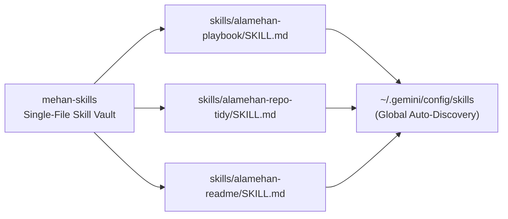

<div align="center">
  <picture>
    <source media="(prefers-color-scheme: dark)" srcset="./assets/readme-header-dark.svg" />
    <source media="(prefers-color-scheme: light)" srcset="./assets/readme-header-light.svg" />
    
  </picture>

  <p>
    <strong>English</strong> · <a href="./README.id.md">Bahasa Indonesia →</a>
    &nbsp;&nbsp;·&nbsp;&nbsp;
    <a href="./skills"><strong>✨ Browse Skills</strong></a> ·
    <a href="https://alamehan.github.io">Portfolio</a> ·
    <a href="./LICENSE">MIT License</a>
  </p>
</div>

> ⚡ Single-file playbooks that guide AI agents to challenge ideas, ship clean craft, untangle repos & write clear docs — crafted by @alamehan
>
> `ai-agents` `agent-skills` `prompt-engineering` `claude-code` `cursor` `antigravity` `developer-tools` `software-quality`

---

## Why Mehan Skills Exists

Every time you start a new project or open a fresh AI chat session, repeating the same standards — how an idea should be challenged without bias, how interfaces and code should be verified end-to-end, how a messy repository should be untangled safely, or how documentation should speak clearly to both everyday readers and engineers — takes time and easily drifts when those instructions only live inside old conversations.

**Mehan Skills** turns repeatable Product Design and Product Engineering workflows by **[M. Raihan Rafiiful Allaam (`@alamehan`)](https://alamehan.github.io)** into **self-contained, single-file playbooks**. Each skill lives inside one `.md` file that your AI coding assistant can load automatically across every workspace, or that you can attach directly inside any web chat whenever you need consistent craft.

---

## Try or Explore Right Now

| What you want to do | Where to go |
|---|---|
| **Challenge ideas without bias, build & debug to production craft, keep repos evergreen, sync docs & run a `0%`-memory release audit (`playbook`)** | Open **[`alamehan-playbook`](./skills/alamehan-playbook/SKILL.md)** |
| **Clean up a messy project folder safely without breaking anything** | Open **[`alamehan-repo-tidy`](./skills/alamehan-repo-tidy/SKILL.md)** |
| **Create a welcoming, bilingual GitHub README with a 2.5D animated header** | Open **[`alamehan-readme`](./skills/alamehan-readme/SKILL.md)** |
| **See other products, design systems & case studies by `@alamehan`** | Visit **[alamehan.github.io](https://alamehan.github.io)** |

---

## Highlights

- **One File, Complete Clarity:** Every skill is written inside a single `SKILL.md` file with all rules, visual templates, and quality checks included — nothing fragmented across extra folders.
- **End-to-End Engineering, UX & Release Playbooks (`alamehan-playbook`):** Type `playbook` (or ask naturally) to pick from 12 everyday situations — from first-principles ideation and anti-bloat convergence to root-cause debugging, real-browser responsive checks, evergreen architecture, `git diff` doc sync, and isolated `0%`-memory release sign-off.
- **Safe Repository Tidying (`alamehan-repo-tidy`):** Teaches AI agents to lock critical paths first, untangle messy scripts and folders, update every affected reference, and verify that everything still builds and passes tests.
- **Human-First Bilingual Documentation (`alamehan-readme`):** Guides AI agents to lead with a clear, approachable story, real embedded designer typography (`Bricolage Grotesque` + `Figtree` + `Geist Mono`), copy-ready GitHub *About* + *Topics*, and collapsible developer drawers — paired in English and natural Indonesian.
- **Works Wherever You Work:** Auto-activates globally in local AI IDEs like Antigravity, or works by simply attaching one `.md` file in Claude, ChatGPT, Cursor, or Codex.

---

## For Developers & Technical Details

<details>
<summary><strong>🛠️ Quick Setup — Global Auto-Discovery &amp; Direct File Use</strong></summary>

### Option 1 · Automatic Global Discovery (Antigravity / Gemini)
Clone this repository once and link `./skills` to `~/.gemini/config/skills` so every skill inside this vault activates automatically across all local workspaces:

```powershell
# Windows PowerShell (no Administrator rights needed)
git clone https://github.com/alamehan/mehan-skills.git
cd mehan-skills
New-Item -ItemType Directory -Force -Path "$HOME\.gemini\config" | Out-Null
New-Item -ItemType Junction -Path "$HOME\.gemini\config\skills" -Target "$PWD\skills"
```

```bash
# macOS / Linux
git clone https://github.com/alamehan/mehan-skills.git
cd mehan-skills
mkdir -p "$HOME/.gemini/config"
ln -sfn "$PWD/skills" "$HOME/.gemini/config/skills"
```

### Option 2 · Direct Attachment (Claude Web, ChatGPT, Cursor, Codex)
Attach the single `SKILL.md` file from [`skills/`](./skills) alongside your target repository and ask the assistant to run that workflow.

</details>

<details>
<summary><strong>🏗️ Skill Catalog, Architecture &amp; Repository Map</strong></summary>



| Path | Role |
|---|---|
| [`skills/alamehan-playbook/SKILL.md`](./skills/alamehan-playbook/SKILL.md) | Universal 12-playbook engineering, UX, visual/responsive, synthesis, evergreen, `git diff` doc-sync, and `0%`-memory release sign-off suite (`playbook`). |
| [`skills/alamehan-repo-tidy/SKILL.md`](./skills/alamehan-repo-tidy/SKILL.md) | Non-destructive repository untangling, symmetric folder grouping, blast-radius reference tracing, and build/test parity verification. |
| [`skills/alamehan-readme/SKILL.md`](./skills/alamehan-readme/SKILL.md) | Adaptive `Porcelain SaaS` 2.5D kinetic `@alamehan` SVG templates (with embedded designer fonts), GitHub About hook, and progressive `EN`/`ID` README rules. |
| [`assets/`](./assets) | Adaptive Dark and Light `Porcelain SaaS` 2.5D kinetic `@alamehan` SVG showcase banners. |
| [`AGENTS.md`](./AGENTS.md) | Authoring rules (`1 Skill = 1 SKILL.md`, clean portable paths, and bilingual catalog sync). |

</details>

<details>
<summary><strong>🧭 Authoring Rules &amp; Design Boundaries</strong></summary>

- **Strictly Single-File Portability:** Each skill embeds its own instructions and checklists inline inside `skills/<slug>/SKILL.md` so it never breaks when shared or attached as a standalone file.
- **Portable Paths Only:** Snippets use `$PWD` and `$HOME` rather than machine-specific drive paths so cloning works identically on Windows, macOS, and Linux. See [`AGENTS.md`](./AGENTS.md) when adding new skills.

</details>

---

Designed and built with care by **[M. Raihan Rafiiful Allaam (`@alamehan`)](https://alamehan.github.io)** — *Product Designer & Product Engineer*. Released under the [MIT License](./LICENSE).
